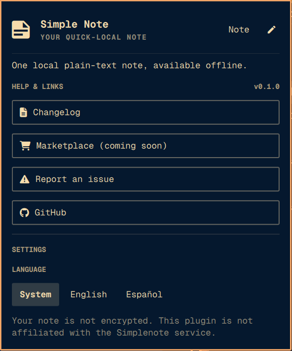

# Omarchy Simplenote

An Omarchy shell plugin for one local plain-text note. It is unrelated to the
Simplenote service and does not sync or use an account.



## Status

Simple Note keeps one local note. The bar button opens a read-only panel; its
edit button opens a separate editor. A configurable shell shortcut can open the
editor directly. Edits are saved after a short pause and closing requests an
immediate save. Selecting text in either view copies it to the clipboard after
a short pause.

Errors and conflicts stop saving and retain unsaved text in memory while the
plugin is active. Retry is available after an error. External changes are
checked periodically; conflicts offer a choice of local or external text.

The plugin targets Omarchy 4.5 and later. It has been exercised on Omarchy
4.5.0: the editor and panel were opened, the configured shortcut was tested,
and copy-on-select was checked in the editor. Automated tests cover storage,
conflicts, translations, selection copying, and QML wiring. Other versions and
less common failure/recovery paths have not all been manually tested.

Omarchy plugins run without a sandbox, with the user's permissions. Review a
plugin and its dependencies before installing it.

## Installation and removal

Omarchy 4.5 and later are the target. Python 3 and a Linux filesystem supporting
`renameat2` exchange are required. There is no network service, account, or root
requirement. The plugin runs Python as your user and can read and write your
note directory.

Install from the public repository with `omarchy plugin add
https://github.com/danielmrdev/omarchy-simplenote.git` and follow the prompts;
this clones and validates the plugin. Enable it with
`omarchy plugin enable danielmrdev.simplenote` and choose a bar placement if
desired. Enabling or changing the bar affects your running desktop. No shortcut
is installed automatically.

To uninstall, first preserve any visible unsaved text, then run
`omarchy plugin remove danielmrdev.simplenote` and follow its confirmation
prompts. Removal retains the separate note data directory described below.
Inspect that directory and its recovery files before deleting it manually.

## Editor command and shortcut

With the plugin enabled, open or refocus the editor with:

```sh
omarchy-shell danielmrdev.simplenote.editor open
```

For a user-configured Hyprland shortcut, add your preferred binding to your
Hyprland configuration; for example, in `~/.config/hypr/bindings.lua`:

```lua
o.bind("SUPER + CTRL + ALT + N", "Simple Note", "omarchy-shell danielmrdev.simplenote.editor toggle")
```

No binding is installed or modified automatically. The toggle closes an open
editor or opens it on the focused monitor. The service owns the editor, so the
widget is not required in the bar. If the focused monitor is unavailable, it
falls back to the first available screen. The editor was opened through the
shell command and configured shortcut in Omarchy 4.5.0; focus and monitor
fallback behavior have not been verified on every setup.
The edit button's tooltip discovers bindings with the `Simple Note` description
or an explicit editor command in Hyprland's binding list; other descriptions
for Lua bindings cannot reliably be identified.

## Data and limitations

The note is stored as plaintext at
`${XDG_CONFIG_HOME:-~/.config}/omarchy-simplenote/note.txt`; it is **not
encrypted** and is unsuitable for secrets. New files are created with mode
`0600` and the new data directory with `0700`, subject to existing directory
permissions. Python 3 and a Linux filesystem supporting `renameat2` exchange
are required. No root privileges or network access are needed.

Each replacement retains the displaced file as `history-*.txt` in the same
directory. The ten most recent normal history files are retained and older
ones are deleted automatically. These copies contain plaintext, just like the
note. Rotation is not a backup guarantee: an external editor still writing to
an old file descriptor can write to an inode whose history entry was removed,
and those changes can be lost.

Detected conflicts are kept separately as `conflict-*.txt`; an interrupted
replacement can leave a `.pending-*` file. Neither is rotated automatically.
At 32 such protected files combined, saving pauses with a visible error and
unsaved edits remain in memory while the plugin is active. Close external
editors, inspect these files, deliberately remove copies you no longer need,
then use Retry. Files named `recovery-*.txt` from older plugin versions are
also left for manual inspection. Removing the plugin does not remove this
directory or its contents. To delete the data deliberately, remove the
directory yourself after checking its contents.

For example, after confirming the directory contains nothing you want to keep,
delete it with `rm -r -- "${XDG_CONFIG_HOME:-$HOME/.config}/omarchy-simplenote"`.
This permanently removes the note and all recovery copies.

The history limit bounds the number of normal copies, not the size of changes
written later by external programs to open file descriptors. Such writes, or
legacy recovery files, can still exhaust disk space.

The helper checks the last-read revision before saving and retains the inode
displaced by an atomic exchange. If that inode differs, saving pauses with a
conflict and the external version is read from a protected conflict file; the
current note may already contain the local version. Either version can be
chosen after the note and protected copy are checked again. If the note changes
again, the latest note is shown as the external version and the earlier
displaced copy remains in the conflict file for inspection. External programs can hold old file
descriptors and write after the check, or replace the path after the plugin's
write: these changes cannot be reliably detected or coordinated with
uncooperative programs. A late write to the displaced inode may not raise a
warning and may be lost after history rotation. Do not edit the note externally
while using the plugin if that limitation is unacceptable. Protected conflict
files remain after resolution and can be inspected or deliberately removed.
If a helper is interrupted before reporting a conflict, inspect these files
manually. Preserve visible unsaved text before disabling the plugin
or restarting the shell, because memory is not persistent.

Notes are limited to 1 MiB of UTF-8. Larger or invalid UTF-8 files report an
error rather than being overwritten. If a note or protected recovery copy is
too large, back it up before reducing the file externally and retrying. For an
oversized unsaved edit, reduce the text in the editor and retry; it remains in
memory only while the plugin is active.

## Development

See [CONTRIBUTING.md](CONTRIBUTING.md). The
[Omarchy plugin development guide](https://plugins.omarchy.org/develop.html)
describes the plugin contract and validation tools.

## Releases

Changes are recorded in [CHANGELOG.md](CHANGELOG.md). See the
[0.1.0 source](https://github.com/danielmrdev/omarchy-simplenote/tree/v0.1.0)
for this version.

## License

This project is licensed under the [MIT License](LICENSE).
